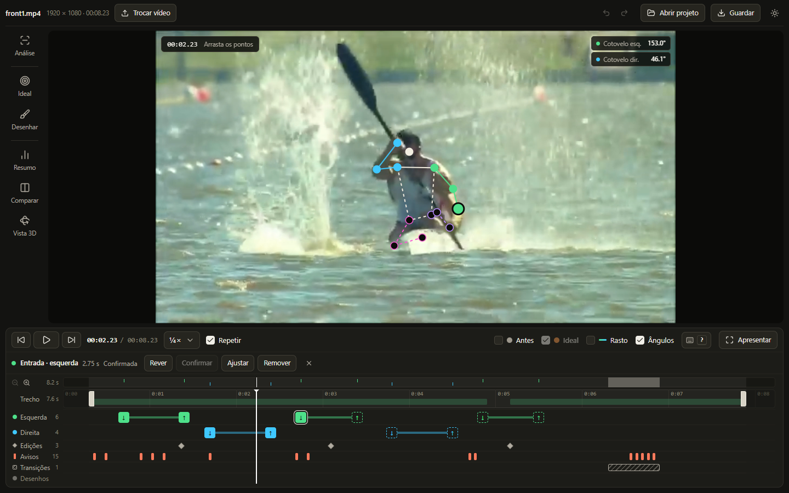
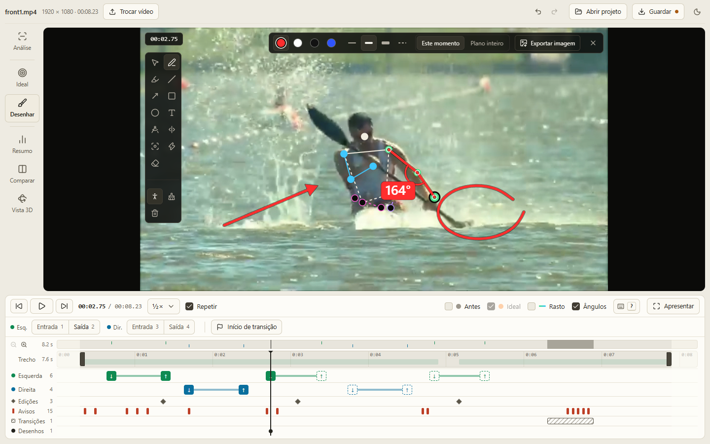
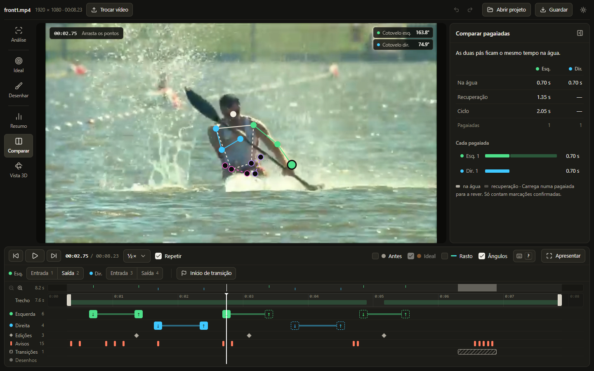

# Stroke

Stroke is a local kayak technique studio for reviewing sprint footage. It tracks an athlete, overlays a pose on the video, and gives the coach a video-editor-style workspace for correcting joints, marking strokes, drawing over the picture, and sketching an ideal movement.

The app is currently a **desktop beta (v0.2.1)**, with build targets for Windows x64 and Apple Silicon Macs (M1 and newer). Analysis and project data stay on the computer; no account or cloud upload is required.



## Current features

**Editor layout**

- The video is always the largest thing on screen and the page never scrolls. A slim top bar whose tabs (**Deteção**, **Tempos**, **Vista 3D**) open and close the inspector on the right; with it closed the video takes the full width. **Editar ideal** and **Desenhar** sit next to **Apresentar** on the transport bar.
- A timeline dock with one shared time axis and fixed lanes: **Trecho** (draggable grips), **Esquerda** and **Direita** (entries, exits and time in the water), **Edições**, **Avisos**, **Transições** and **Desenhos**.
- A whole-clip map above the lanes shows the trecho, cuts, marks and playhead. Drag its window to pan; zoom with the buttons, **+**/**−** or the mouse wheel (Shift+wheel pans). Analysed clips longer than 30 s open on a 20 s window.
- **Apresentar** (**F**) leaves only the video and transport, for showing the athlete. **?** lists every shortcut.

**Analysis**

- Automatic pose tracking with progress and cancellation, an optional detailed mode (Heavy model, up to 30 fps) and an optional fixed athlete region saved with the project
- Camera cuts are detected and become transitions: tracking restarts after each cut, a cut next to a transition you drew extends it, and cuts you remove stay removed when you analyse again
- Editable joint positions with local interpolation and undo/redo; low-confidence joints use hollow points and dashed bones
- Experimental **Vista 3D**: synchronized, rotatable upper-body skeleton with front, side, and top views

**Marking strokes**

- One-click entry and exit marks: keys **1**–**4** mark left/right entry/exit, as do the buttons above the lanes
- Drag a mark along its lane to move it, or step it by single frames; **Delete**/**Backspace** removes the chosen mark or transition. Marks never land inside a transition
- Confirm, replay in slow motion, change side, ignore/restore, all undoable
- **Tempos**: cadence, left/right averages, per-stroke timing and stroke replay from confirmed marks, grouped by camera shot when the clip has cuts, plus the project notes. Replaying a stroke restores the previous speed afterwards

**Drawing over the video**

- **Desenhar** (**D**) opens a telestrator: pen, marker, arrow, line, rectangle, circle, text, angle, plumb line, spotlight, laser and eraser
- A drawing belongs to one moment (it fades while playing) or to the whole shot (**Plano inteiro**, until the next cut or transition)
- Lines and angles snapped to joints follow the athlete; **Exportar imagem** saves the current frame as a PNG
- Drawings are saved in the project

**Everything else**

- Slow playback, frame stepping, looping and wrist trails. The overlay follows the frame actually on screen, and a video that stops decoding is restarted automatically
- 2D elbow and knee angles, and an editable ideal-motion overlay for visual comparison
- Portable, versioned `.stroke.json` projects; paddle and reference points from older projects still display
- Native file dialogs, crash recovery and remembered video locations
- Light and dark themes, following the system by default and switchable from the header





The interface is in European Portuguese.

## Install and run

The current release is built for Windows x64:

1. Run `release/Stroke-0.2.1-Windows-x64-Setup.exe`.
2. Install Stroke for the current Windows user.
3. Open **Stroke** from the desktop or Start menu.

The installer does not require administrator access, Python, or Node.js. The unpacked build is also available at `release/win-unpacked/Stroke.exe`; keep that folder together when moving it.

For more detail about the packaged app, diagnostics, recovery, and release builds, see [DESKTOP.md](DESKTOP.md).

GitHub Actions builds and publishes both installers after merges into main. Download them from the [Latest release](https://github.com/DuarteFaria/Stroke/releases/latest). To rebuild manually, open **Actions → Desktop installers → Run workflow** on main. The workflow also runs for relevant pull requests and `v*` tags. macOS users choose `Stroke-macOS-arm64`, open the `.dmg`, and drag Stroke to Applications. These builds have no Apple Developer ID signature or notarization; first launch may require **System Settings → Privacy & Security → Open Anyway**. Intel Macs are not supported by the current analyzer dependency.

## Basic workflow

1. Open a video. In **Deteção**, set the trecho (up to 120 seconds) with the grips or **I**/**O**, and optionally the detail level and athlete area.
2. Choose **Detetar a minha remada** to track the athlete. Analysis finds camera cuts but does not add stroke marks.
3. Mark entries and exits with **1**–**4** or the buttons above the lanes. Click a mark to replay it in slow motion, then **Confirmar**, **Ajustar** or **Remover**; drag it to move it, **Delete** to remove it.
4. Drag any joint on the video to correct it. **Ideal** sketches the target pose; **Desenhar** draws over the video for the athlete.
5. Read the timings in **Tempos**, and use **Apresentar** to review with the athlete.
6. Save the session as a `.stroke.json` project with **Guardar** or `Ctrl+S`.

Project files contain analysis and edits, but not the source video. Keep the original footage alongside the project or reconnect it when prompted.

For 3D, analyse a clip and select **Vista 3D**. Drag to rotate or use the view buttons and sliders. New analysis saves estimated hip-relative 3D landmarks in v2 projects; this app still opens v1 projects. Older analyses need the original video reanalysed, which replaces corrections within the selected segment through the existing confirmation flow. Save a copy first if you want to retain those edits. Older app releases cannot open v2 projects. Project files can now be up to 100 MB to accommodate both 2D and 3D data.

The 3D view offers a short-window smoothed preview and an original-output toggle, independent of 2D corrections. Low-visibility joints are hidden by default and can be revealed. Smoothing may attenuate fast motion and does not fix incorrect depth or body geometry. The camera fits the selected clip at a fixed scale; reset restores the fitted view. Depth is inferred from a single camera and has not been validated for kayaking. Visibility is not depth accuracy. Missing estimates and marked transitions remain gaps. The view does not reconstruct the paddle, submerged limbs, boat-relative movement, or calibrated measurements; the existing angle readouts remain 2D.

## Project status

The next development phase is [better 2D detection](docs/DETECTION-PLAN.md), starting
with repeatable coverage reports and manually reviewed reference footage.

Stroke is a functional editor prototype, not validated biomechanics software or an automatic coaching verdict.

Current limits:

- Tracking samples at up to 15 fps for responsive CPU analysis.
- Measurements are 2D image-plane projections, not 3D motion or force estimates.
- Entry/exit marking is manual and the paddle is not tracked. Paddle points in older projects still display. See [the review guide](docs/STROKE-REVIEW.md).
- Occlusion, crossing limbs, clothing and multiple athletes can reduce accuracy. Hard camera cuts are detected, but slow dissolves may need a transition drawn by hand.
- Video files are limited to 1 GB and analysis segments to 120 seconds.
- The ideal pose is a free 2D sketch; it does not enforce limb lengths or render a new video.
- The Windows installer is currently unsigned, with no automatic updater.

## Development

Requirements for a fresh development machine:

- Windows
- Python 3.12
- Node.js 24
- pnpm 11

Run `Setup-Stroke.ps1` once to install the pinned dependencies and pose model. Codex bundled runtimes are detected automatically when available.

### Browser development

```powershell
./Start-Stroke.ps1
```

This starts the local frontend and analyzer at `http://127.0.0.1:3000`. Use `Stop-Stroke.ps1` to stop them.

### Desktop development

```powershell
./Start-Desktop.ps1
```

### Validation

```powershell
cd app
pnpm build
pnpm typecheck
pnpm lint
pnpm test

cd ..
.venv/Scripts/python.exe -m pytest tests -q
```

The desktop smoke test covers the real renderer, authenticated local API, native project/video handling, decoding and inference, saving, reopening, and recovery. It can optionally save screenshots of the packaged app by setting `STROKE_SCREENSHOT_DIR` before running the test.

## Repository layout

```text
app/       React and TypeScript editor
backend/   FastAPI and MediaPipe analyzer
desktop/   Electron shell and desktop smoke test
examples/  Sample .stroke.json project
```

The core editor is in `app/app/Studio.tsx`, the timeline dock in `app/app/Timeline.tsx`, drawing in `app/app/Drawing.tsx` and `app/lib/drawings.ts`, motion and project logic in `app/lib/motion.ts`, and the local analyzer in `backend/main.py`.

## License

Stroke is licensed under the [MIT License](LICENSE). Third-party dependencies and pose models retain their respective licenses.

### 3D preview stabilization

The stabilized preview keeps robust arm lengths within each continuous tracking
run and preserves them between sampled frames. It corrects sudden complete
left/right flips only when both shoulders and hips agree in image and world
coordinates over adjacent samples. Crossed wrists or screen position alone never
change side labels. Cuts, tracking restarts and missing estimates reset continuity.
The first frame anchors identity; an initially mislabelled pose, isolated arm swap
or incorrect depth can still require better tracking or reanalysis.

The E/D labels and colours refer to the athlete's anatomical left/right, including
when the view is rotated. Original output remains available, and raw saved analysis
and 2D corrections are unchanged. Stable lengths are a display constraint, not
calibrated anatomy or proof that the inferred pose is correct.
